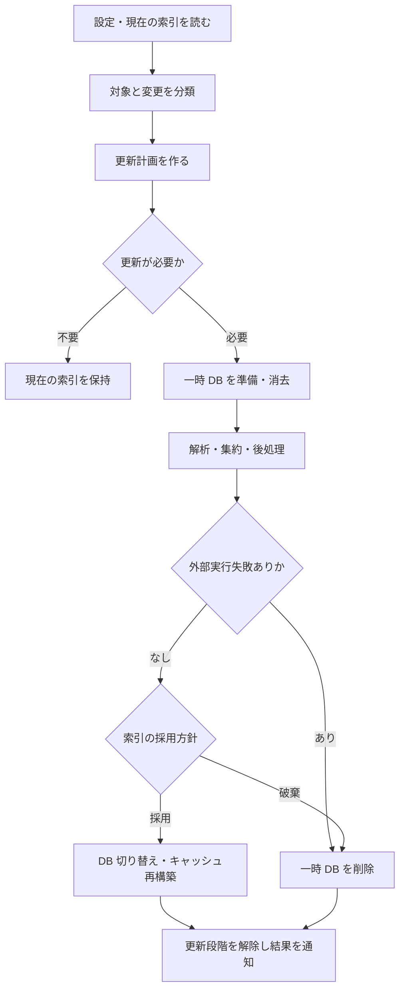

# 索引化・更新・公開のライフサイクル

## 状態の読み方

`Project` は、読み込み状態（未読込、空、読込済み、設定変更、旧形式、移行要、破損）と、更新段階（`NONE`、`REFRESHING`、`INDEXING`）を別々に持つ。索引化中の再度の `buildIndex` は拒否される。[Project.h](../../src/lib/project/Project.h)、[Project.cpp](../../src/lib/project/Project.cpp)



この図は通常の操作の経路であり、クラッシュ時に原子的に切り替わる保証ではない。

## 更新モード

| モード | 更新計画 | 注意点 |
| --- | --- | --- |
| 全体更新 / `REFRESH_ALL_FILES` | 有効な Source Group の、現在存在する全ソースを索引化する | `filesToClear` が空なのは旧 DB の差分消去をしないため |
| 更新分 / `REFRESH_UPDATED_FILES` | 変更・削除・追加と依存関係から消去／索引化集合を求める | 入力分類と依存スナップショットが前提 |
| 更新分と不完全 / `REFRESH_UPDATED_AND_INCOMPLETE_FILES` | 更新分に、不完全ファイルとその依存元を加える | 変更時刻が同じでも不完全な解析を再試行できる |
| 初期値 / `REFRESH_NONE` | `Project::refresh` で必要なモードを選ぶ | 独立した解析アルゴリズムではない |

根拠: [RefreshInfo.h](../../src/lib/project/RefreshInfo.h)、[RefreshInfoGenerator.cpp](../../src/lib/project/RefreshInfoGenerator.cpp)。

## 入力分類と純粋な計画を分ける

[RefreshPlan](../../src/lib/project/RefreshPlan.h) は、入力集合と読み取り専用の依存問い合わせから `filesToClear` と `filesToIndex` を返す既存アダプターである。集合演算の本体は [src/lib_core/RefreshPlanner.h](../../src/lib_core/RefreshPlanner.h) に移し、`FilePath`、コールバック、ファイルの存在確認、mtime、SQLite、UI への依存を持たない。実運用のアダプターは `PersistentStorage` を読むため、同一スナップショットを読むという前提のもとで決定的な計画となる。新しいスナップショットロックは追加していない。

コアは二段階の値処理とする。まず `prepareUpdatedRefresh` が変更と依存元から当初の消去対象・保持するソースを求める。アダプターがその二集合の依存先を読むと、`finishUpdatedRefresh` が最終の集合を返す。依存問い合わせの順序は `referencing(変更)` → `referenced(保持ソース)` → `referenced(当初の消去対象)` のまま保つ。計画の前に全グラフを取得したり、コア内で新しい閉包を計算したりしない。[ADR-0006](../adr/0006-portable-refresh-core.md)

| 記号 | 入力・中間結果の意味 |
| --- | --- |
| `S` | 現在の有効な全ソース |
| `U` | 変更されていない索引済みファイル |
| `C` | 変更・削除等で更新対象になった既知ファイル |
| `Referencing(X)` | `X` に依存するファイルの集合 |
| `Referenced(X)` | `X` が依存するファイルの集合 |
| `B = C ∪ Referencing(C)` | 変更と、その影響を受ける依存元 |
| `S₀ = S − B` | 当初の消去対象から外れるソース |
| `K = Referenced(S₀)` | 保持するソースが必要とする依存先 |
| `D = Referenced(B)` | 更新する側の依存先 |

返す集合は次の通りである。

```text
Clear = B ∪ (D − K − S₀)
Index = { s ∈ S : s ∈ Clear または s ∉ U }
```

共有ヘッダーを保持するため、保持するソースが引き続き必要とする依存先を、孤立した依存先と同じ扱いで消さない。ただし、そのファイル自体が `B` に含まれる場合は消去対象となる。「共有されているファイルは絶対に消さない」という契約ではない。[RefreshPlanner.h](../../src/lib_core/RefreshPlanner.h)

この式が対象にするのは **更新計画** である。再解析が正しいグラフを生成すること、mtime 判定が全ての変更を拾うこと、DB 切り替えが障害に耐えることは別の契約になる。[ADR-0002](../adr/0002-pure-refresh-planning.md)、[ADR-0003](../adr/0003-bounded-formal-verification.md)

### 依存関係の現行仕様

`PersistentStorage` は include の到達可能集合と import の到達可能集合を別々に計算し、結果を和集合にする。include と import を一つのグラフに混ぜてから推移閉包を取る処理ではない。純粋計画の呼び出し側は、計画中に変化しない同一スナップショットを提供する必要がある。[PersistentStorage.cpp](../../src/lib/data/storage/PersistentStorage.cpp) の `getReferenced`／`getReferencing` を参照。

### 純粋計画の外に残る判定

`RefreshInfoGenerator::didFileChange` は、現在の最終更新時刻が保存時刻より新しい場合に内容を比較する。保存時刻と同じ、または過去の時刻に置き換えられた内容の変更を一般に検出する契約ではない。全体更新・不完全再試行は別の経路である。

保存される `file.modification_time` の意味は生産元に依存する。内蔵保存処理は時刻が未指定ならファイルの最終更新時刻を補う。一方、固定した Python 索引器 `v1_db25_p6` は `recordFile` を通じ、同梱 SourcetrailDB の `addFile` が `time(0)`、すなわち索引時の時刻を保存する。このため、コピー元の古い mtime に数秒足すだけでは、Python の変更検出条件を満たすとは限らない。[内蔵保存処理](../../src/lib/data/storage/sqlite/SqliteIndexStorage.cpp)、[固定版 Python の呼び出し](https://github.com/CoatiSoftware/SourcetrailPythonIndexer/blob/eba5d0fe5059431bc479b2b36a814b6a9a21bde4/indexer.py)、[同梱 DB 実装](https://github.com/CoatiSoftware/SourcetrailDB/blob/6e291ea6dc4e2015a09548a7f5174d09d7beeeed/core/src/SourcetrailDBWriter.cpp)（確認日: 2026-10-30）。

内容変更を検査する試験では、変更後の mtime が保存時刻より新しくなるよう入力を作る。現行の Python E2E は、直前の索引化が終了した後で `max(元の mtime, 現在時刻) + 2 秒` に進め、秒精度による同時刻判定を避ける。これはテストの入力条件を明確にするものであり、同時刻変更の一般的な検出を実装するものではない。[test_e2e.py](../../tests/python/test_e2e.py)、[GAP-002](evolution-plan.md#gap-002-更新時刻に依存する変更検出)

計画後に、保存上の `indexed` に従って `filesToClear` と `nonIndexedFilesToClear` を分ける。`RefreshPlan` はその分類を行わない。不完全ファイルの追加処理も `RefreshInfoGenerator` に残る。

## 実行経路の違い

### C++／Java

`Project::buildIndex` は内部コマンドのキュー投入、解析ワーカー、`IntermediateStorage` の集約、永続化への注入をタスクとして組み合わせる。`Storage::inject` でローカル ID を保存先 ID に写す。各注入では `PersistentStorage::startInjection`／`finishInjection` が SQLite トランザクションを開始・確定する。[TaskBuildIndex.cpp](../../src/lib/data/indexer/TaskBuildIndex.cpp)、[TaskMergeStorages.cpp](../../src/lib/data/TaskMergeStorages.cpp)、[TaskInjectStorage.cpp](../../src/lib/data/TaskInjectStorage.cpp)

### Python／Custom

外部プロセスを起動し、作業用DBに索引を書かせる。並列実行では追加ワーカーごとのDBに書いた結果を注入する経路もある。Pythonには未解決参照の後処理があり、曖昧な候補を追加する。[TaskExecuteCustomCommands.cpp](../../src/lib/data/indexer/TaskExecuteCustomCommands.cpp)

`EXECUTION-001` は、外部コマンドの実行エラー・非ゼロ終了・終了コード0を値として分類し、実行単位で開始数・結果確定数・成功数・失敗数を集約する。一度記録した失敗は後続の成功で消さず、既存の索引済み件数には成功分だけを加える。値処理は [ExternalIndexerOutcome](../../src/lib_core/ExternalIndexerOutcome.h)、並列更新の同期は [ExternalIndexerRunState](../../src/lib/data/indexer/ExternalIndexerRunState.h) が担当する。

失敗を含む実行ではPython後処理を省き、終了処理へ失敗を渡す。タスク列の `STATE_SUCCESS` は後始末へ進むためのスケジューラー上の完了であり、外部実行の成功という意味ではない。別の実行結果を持つことで、候補DBの処分と更新段階の解除を飛ばさずに終了できる。[ADR-0007](../adr/0007-external-indexer-outcomes.md)

stderrへ警告を出した終了コード0や、DBへ書き込まない終了コード0も、プロセスの分類では成功する。実行成功と構文診断・意味的完全性を区別し、必要な記号・関係・位置・診断は別の期待値と観測で確認する。[外部実行結果の契約](../contracts/external-indexing.md)

Python の Source Group は `allowsPartialClearing() == false` である。`Project::buildIndex` は、消去予定のファイルに対し、有効かつ部分消去を許可しない各グループの `filterToContainedFilePaths` を呼ぶ。これは設定上のソースパスと除外条件による所属判定なので、現在のソース列挙から消えた削除済みファイルも対象になる。先のグループに該当しなければ後のグループを調べ、所属するグループが見つかればプロジェクト全体を再索引化する。GUI では従来の確認を行い、取り消しを選べる。切り替え時も shallow 指定を保持する。[Project.cpp](../../src/lib/project/Project.cpp)、[SourceGroupPythonEmpty.cpp](../../src/lib_python/project/SourceGroupPythonEmpty.cpp)

この所属判定と複数グループの走査は、本変更の `SOURCE-GROUP-001` による意図した修正である。現在存在するソースの包含を調べる `containsSourceFilePath` とは用途を分ける。Python の「差分更新の E2E が通る」とは、変更後の観測が正しいことを示し、常に変更したファイルだけを処理することは示さない。[GAP-004](evolution-plan.md#gap-004-source-group-の包含判定)

## DB の採用と中断

更新分の処理では既存索引を一時DBにコピーし、解析中も既存状態を参照できるようにする。全体更新は旧索引をそのままコピーする経路ではない。外部実行失敗のない通常経路では `TaskFinishParsing` が最適化と結果表示を行い、採用・破棄・採用後再更新の方針を返す。この通常経路のGUIのない `DialogView::finishedIndexingDialog` は採用を返す。[TaskFinishParsing.cpp](../../src/lib/data/TaskFinishParsing.cpp)、[DialogView.cpp](../../src/lib/component/view/DialogView.cpp)

外部実行失敗がある場合は、候補DBの破棄を選び、GUIの採用選択で上書きしない。採用済みDBがあればそれを維持し、初回索引化なら失敗候補を採用しない。`Project` は候補の処分を終え、更新段階を解除してから `MessageIndexingFinished` に結果を載せる。CLIでは `MessageQuitApplication` まで終了コードを伝え、非ゼロで終了する。スケジューラーの途中失敗に任せて後続処理を飛ばす設計にはしない。[Project.cpp](../../src/lib/project/Project.cpp)、[Application.cpp](../../src/lib/app/Application.cpp)

初回の候補破棄後に、プロジェクト初期化による未版付けの空DBが残る場合がある。DBファイルがあることと、候補索引を採用したことは区別する。人工対象では初期化時の既知の空構造だけを別状態として識別し、採用済みDBがあった場合はその意味スナップショットの厳密一致を要求する。[判定の詳細](../contracts/external-indexing.md#採用していないdbの識別)

取消やタイムアウトをこの結果から一般的に判定する機能は追加していない。`executeProcess` のパイプ読込と期限待ちの順序は追加実験が必要であり、子プロセス・子孫回収・取消後の採用方針を含め [GAP-005](evolution-plan.md#gap-005-外部索引器の失敗と終了状態) に残る。

現行の `swapToTempStorageFile` は旧索引ファイルを削除した後、一時索引を rename する。途中の障害について「必ず旧版か新版のどちらかが残る」という保証は確認できない。モデルの一つの遷移で表せても、そのモデルに実装が従うことの証明にはならない。障害注入・復旧設計は [GAP-001](evolution-plan.md#gap-001-db-公開の障害耐性) として追跡する。

## リファクタリング時の確認順序

1. 入力分類の前提を固定し、`RefreshPlan` の集合結果を比較する。
2. Source Group が生成するコマンドの対象・引数・作業ディレクトリを比較する。
3. 実アプリを起動し、変更・削除・共有依存・診断修復後の DB を比較する。
4. キャッシュを再構築した後の検索・位置取得・グラフ問い合わせを確認する。
5. 外部実行の失敗では、件数・候補の破棄・既存DB・CLI終了・再試行を [人工の外部索引器](../../tests/external_indexer/) で観測する。
6. 公開中の障害や中断の仕組みを変更する場合は、別途障害・復旧の契約と試験を追加する。

この順序により、純粋な集合処理の等価性と、アプリ全体の観測結果を混同しない。

具体的な再現対象には [C++／Python のトイプロブレム](../contracts/toy-problems.md) を使う。初回、無変更、削除、編集を分け、更新後は別ルートの全体更新と比較する。変更前の実装に差が見つかった場合は、既存の不具合の修正と構造変更の同等性を分けて記録し、基準との差を消すために観測を弱めない。
