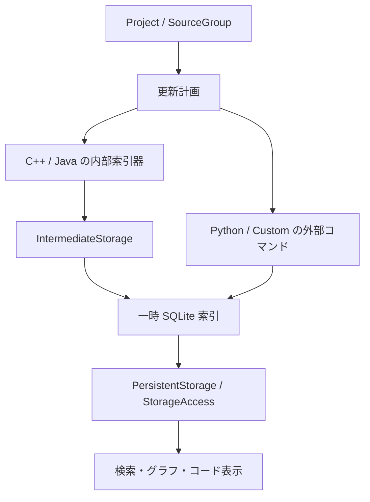

# 内部設計の入口 — Sourcetrail が保持する意味

調査日: 2026-10-30。比較の出発点は `1bc605e8bea8d75abd87121e704c90caa380e44b`。この文書群は、その実装と本変更の更新計画抽出を対象とする。将来構成は「提案」、未検証の性質は「未検証」と明記する。

## 目的と読み順

Sourcetrail の中心的な役割は、ソースコードから**名前・関係・ソース位置・解析状態**を作り、利用者がそれらを検索して行き来できるようにすることである。索引化したプログラムの実行結果や全ての動的呼び出し先を保証するものではない。

リファクタリングでは、同一の入力・解析設定・対応能力の範囲で、この観測結果を保持する。新しい構文を理解できるようにする変更は、従来実装との一致だけでは判定できないため、対応能力を追加する仕様変更として扱う。[ADR-0001](../adr/0001-semantic-observations.md) が比較の原則を定める。

| 調べたいこと | 入口 | 主な検索語 |
| --- | --- | --- |
| 名前・関係・位置が何を意味するか | [概念と用語](domain-model.md) | `NameHierarchy`, `occurrence`, `ambiguous` |
| 全体更新・差分更新・不完全な解析の再試行 | [索引化のライフサイクル](indexing-lifecycle.md) | `RefreshPlan`, `RefreshInfoGenerator`, `incomplete` |
| SQLite と画面から見える問い合わせ | [保存・検索・表示の境界](storage-and-query.md) | `StorageAccess`, `schema 25`, `trail`, `bookmark` |
| 新しい Python／C++／Rust の追加 | [言語互換性と拡張点](language-compatibility.md) | `capability`, `adapter`, `edition`, `C++20` |
| 未確認事項・次の作業・終了条件 | [改善順序と未解決事項](evolution-plan.md) | `GAP-`, `段階`, `受入条件` |
| 設計判断の理由 | [ADR 一覧](../adr/README.md) | `ADR-0001`〜`ADR-0004` |
| 実行できる契約・モデル | [契約ディレクトリ](../contracts/) | `REFRESH-001`, `REFRESH-002`, `TLC` |

## 現在の構成

この図はデータ経路を示す。プロセスの分離、DB の切り替え、キャッシュ構築の順序は [ライフサイクル](indexing-lifecycle.md) を参照する。Python は `LanguagePackageCxx` と同じ内部索引器の経路を通らない。

| 境界 | 現在の責務 | 実装の入口 |
| --- | --- | --- |
| 起動・操作 | GUI／CLI の起動、言語モジュール登録、プロジェクト読み込み | [src/app/main.cpp](../../src/app/main.cpp), [CommandLineParser.cpp](../../src/lib/utility/commandline/CommandLineParser.cpp) |
| プロジェクト | 設定、対象ファイル、更新方法、タスク構成、DB の採用 | [Project.cpp](../../src/lib/project/Project.cpp), [SourceGroup.h](../../src/lib/project/SourceGroup.h) |
| 言語アダプター | ビルド設定から索引化コマンドを作り、言語固有の意味を抽出する | [SourceGroupFactory.cpp](../../src/lib/project/SourceGroupFactory.cpp), [LanguagePackageManager.cpp](../../src/lib/app/LanguagePackageManager.cpp) |
| 共通記録形式 | 記号・参照・位置・診断を記録する | [ParserClient.h](../../src/lib/data/parser/ParserClient.h), [ParserClientImpl.cpp](../../src/lib/data/parser/ParserClientImpl.cpp) |
| 集約と保存 | 中間結果の ID を再対応付けし、SQLite に統合する | [Storage.cpp](../../src/lib/data/storage/Storage.cpp), [PersistentStorage.cpp](../../src/lib/data/storage/PersistentStorage.cpp) |
| 利用者への観測 | 検索候補、関係グラフ、参照位置、診断、ブックマーク | [StorageAccess.h](../../src/lib/data/storage/StorageAccess.h), [controller](../../src/lib/component/controller/) |
| 表示・外部連携 | Qt の描画、操作履歴、IDE との通信 | [lib_gui](../../src/lib_gui/), [NetworkProtocolHelper.cpp](../../src/lib/component/controller/helper/NetworkProtocolHelper.cpp) |

`StorageAccess` には読み取り問い合わせだけでなくブックマークの変更も含まれる。現在の型名を、そのまま将来の分離境界とみなしてはいけない。

## 利用者の操作から必要な契約を探す

| 利用者が期待する操作 | 保持する意味 | DB の一致だけで足りるか |
| --- | --- | --- |
| 名前を検索して対象を開く | 修飾名・シグネチャ・種別・候補・選択先 | 候補の順位・フィルターには問い合わせ層の検証も必要 |
| 呼び出し元／先をたどる | 関係の向き・種別・解決先・曖昧性 | グラフの深さ、方向、親の補完も別途確認 |
| ソースを開いて参照を読む | ファイル・内容・位置・位置種別 | 文字コード、列の単位、描画範囲の検証も必要 |
| ファイル変更後に更新する | 残す情報、削除する情報、再索引化する入力 | 更新計画と実行後の観測を両方確認 |
| 構文エラーを直して再試行する | 診断・不完全状態・修復後の診断除去 | 終了コードだけでは足りない |
| 新しい言語で同じ探索をする | 共通の探索操作を言語ごとの対応能力で満たす | 言語固有の意味の写像と新しい期待値が必要 |

## 「同等」と「改善」を混同しない

保存形式の ID、挿入順、DB のバイト列、処理時間、グラフ上の座標は通常の意味比較では同一である必要がない。一方、オーバーロードを区別するシグネチャ、参照の向き、曖昧な候補、`indexed`／`complete`、ソース位置を消して比較してはいけない。

既存の誤りを直す場合は、その差分を「同等性を保った」と呼ばず、再現条件・変更前後の期待・関連契約を記録する。対応していない構文を無視して同一の空グラフを生成しても、対応能力を満たしたことにはならない。

## 調査の範囲と限界

この文書群は、索引化・永続化・検索の主要な責務と拡張経路を追跡した。全ソース行の監査や、全ての OS・構文・UI 操作の同等性証明ではない。未確認の範囲を隠さないため、[未解決事項一覧](evolution-plan.md) に独立した識別子と受入条件を置く。検証結果の件数・コマンド・出力は各作業レポートを正本とする。
